<div align="center">


# Ops-Free SES

**A Resend-style email API and dashboard that sends through *your own* Amazon SES account.**

Keep Amazon SES pricing ($0.10 per 1,000 emails). Skip the setup and operations work around it.

[](https://nextjs.org)
[](https://www.typescriptlang.org)
[](https://aws.amazon.com/ses/)
[](https://bullmq.io)
[](https://orm.drizzle.team)
[](#testing)

[**Live site**](https://www.opsfree.in) · [**Watch the demo (48 s)**](docs/media/opsfree-tour.mp4) · [Architecture](docs/ARCHITECTURE.md) · [Test evidence](docs/testing/EVIDENCE.md)

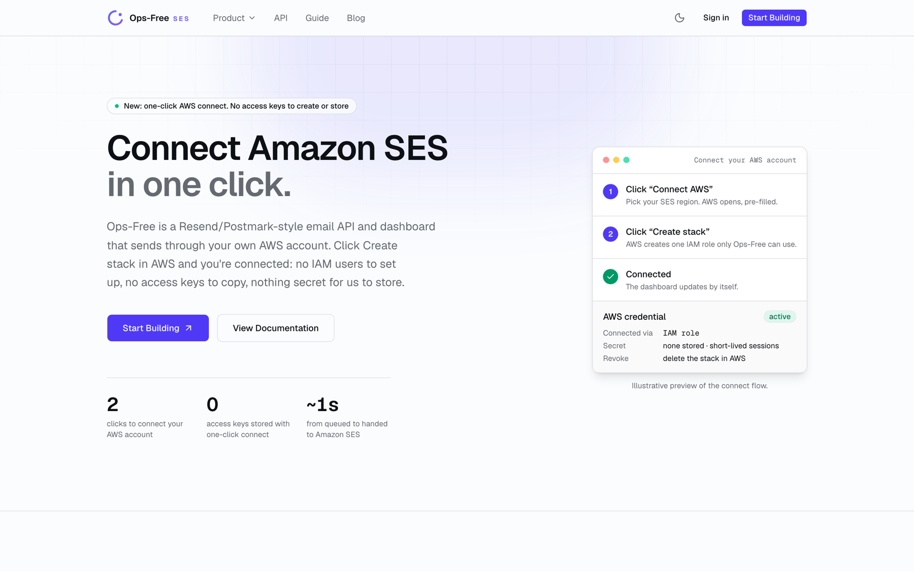

</div>

> [!NOTE]
> **The hosted service is paused for now.** The site at [opsfree.in](https://www.opsfree.in) stays up as a demo with the free tools working, but sign-in and sending are switched off. Everything in this README was recorded from the real app.

---

## What it is

Amazon SES is the cheapest way to send email at scale, but using it properly takes a lot of plumbing: IAM users and keys, DKIM records, SNS topics for bounces and complaints, a webhook that verifies SNS signatures, a suppression list, a queue that respects your send rate, retries, a send log, and a written request to get out of the SES sandbox.

**Ops-Free does all of that for you.** You connect your AWS account in two clicks (a CloudFormation stack creates one scoped IAM role, so no access keys are created or stored). Then you send with a single HTTP call:

```http
POST /api/v1/send
Authorization: Bearer sk_live_...
Content-Type: application/json

{ "from": "hello@yourdomain.com", "to": ["user@example.com"], "subject": "Welcome", "html": "<h1>Hello</h1>" }
```

```json
202 Accepted
{ "id": "3f2a1c9e-…", "status": "queued", "message": "Accepted for asynchronous delivery" }
```

Mail goes out from **your** SES account, so you keep its pricing, quotas and sender reputation. Ops-Free handles the queue, rate limits, retries, delivery events, bounces, complaints and the dashboard.

## Demo

<table>
<tr>
<td width="50%"></td>
<td width="50%">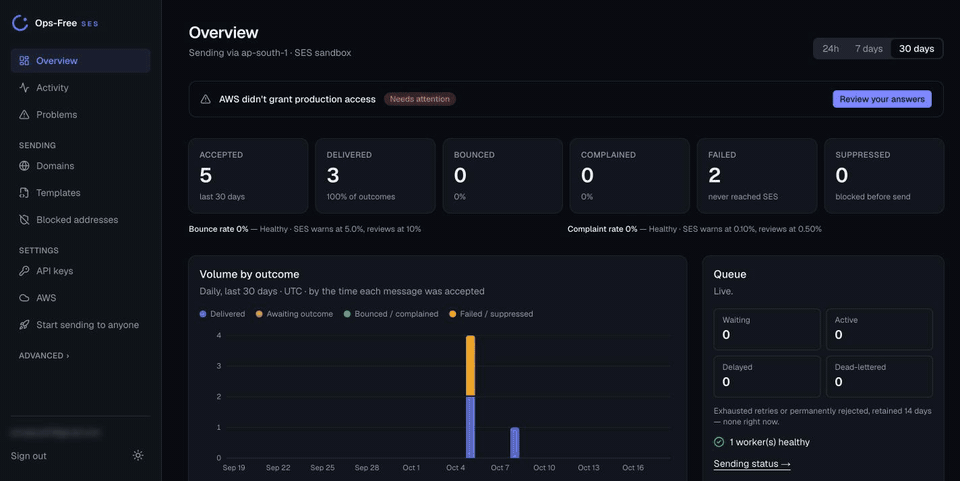</td>
</tr>
<tr>
<td align="center"><sub>Homepage and the free DNS checker</sub></td>
<td align="center"><sub>The dashboard, with real data</sub></td>
</tr>
</table>

Full walkthrough with both parts: [`docs/media/opsfree-tour.mp4`](docs/media/opsfree-tour.mp4)

## 8 setup steps, 5 of them gone

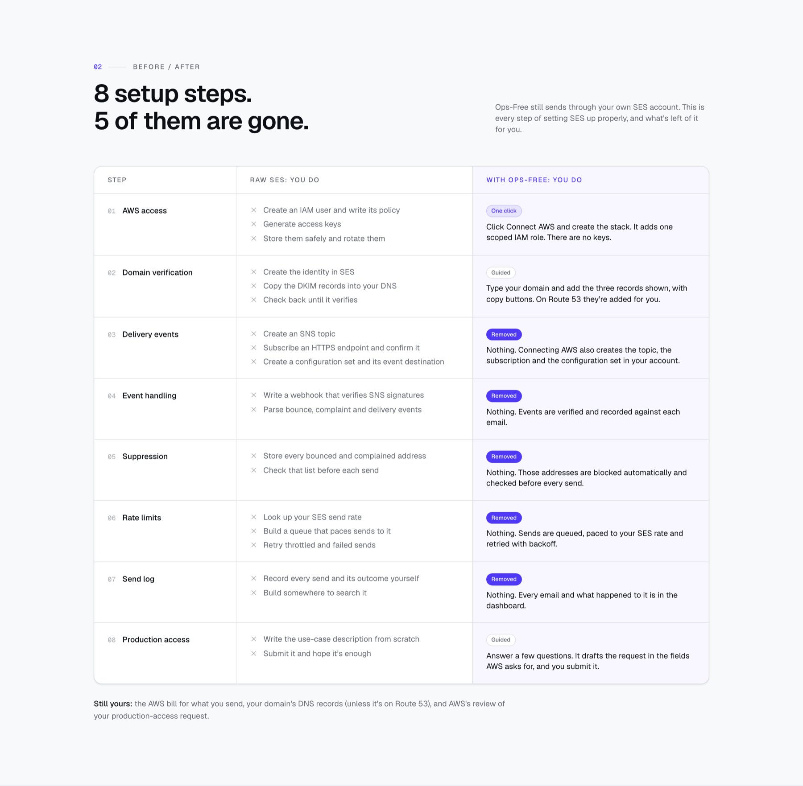

## The dashboard

| | |
|---|---|
| 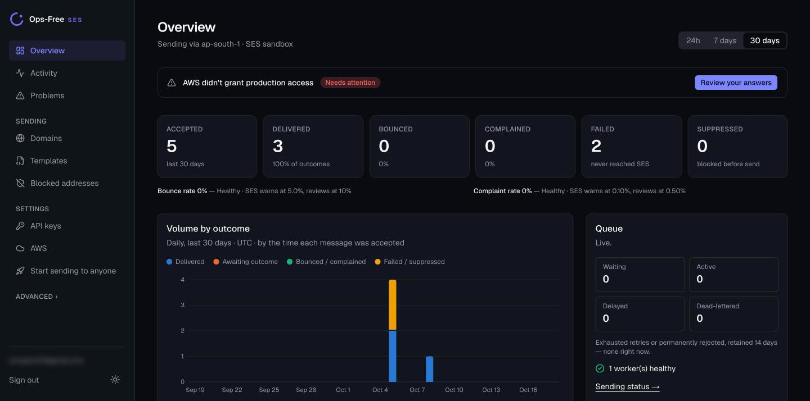 | 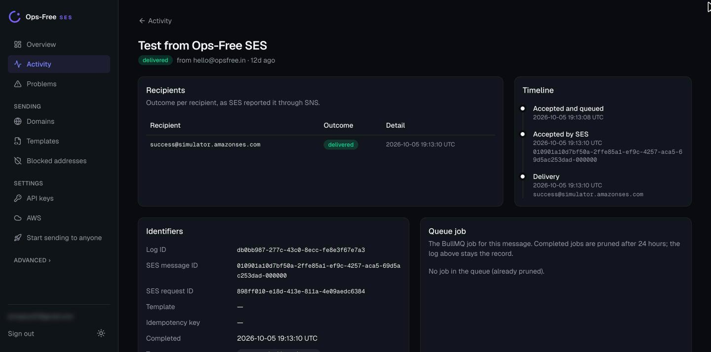 |
| **Overview.** Sends, outcomes, bounce and complaint rates against SES's limits, and the live queue. | **Every message has a timeline.** Queued → accepted by SES → delivered, with the SES message ID. |
| 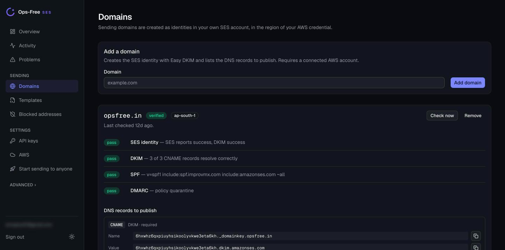 | 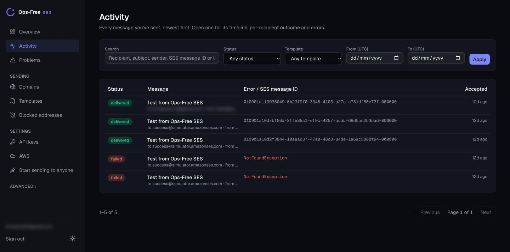 |
| **Domains.** Creates the SES identity, lists the DNS records with copy buttons, and re-checks DKIM, SPF and DMARC until they pass. | **Activity.** Search every message by recipient, subject, status, template or date. |
| 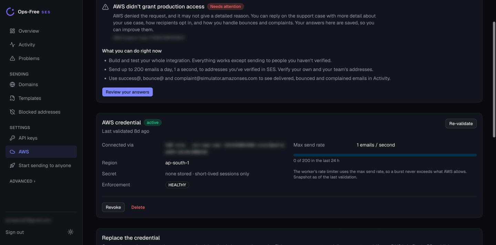 | 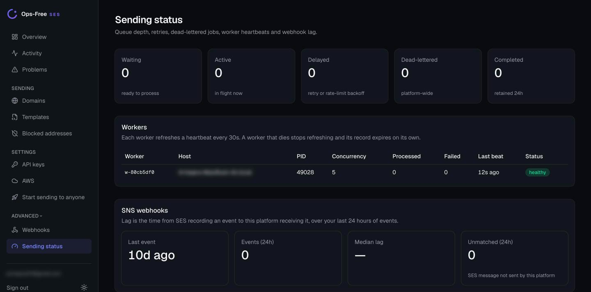 |
| **AWS.** Connected through an IAM role with short-lived sessions. Shows your SES send rate and daily quota. | **Sending status.** Queue depth, retries, dead letters, worker heartbeats and webhook lag. |

Also included: reusable **templates** with `{{variables}}` and version history, a **blocked addresses** list, **API keys** (stored hashed, shown once), separate production and staging environments, and a **production-access assistant** that drafts the SES sandbox-exit request from your answers.

<sub>Personal email addresses and AWS account numbers are blurred in these screenshots.</sub>

## How it works

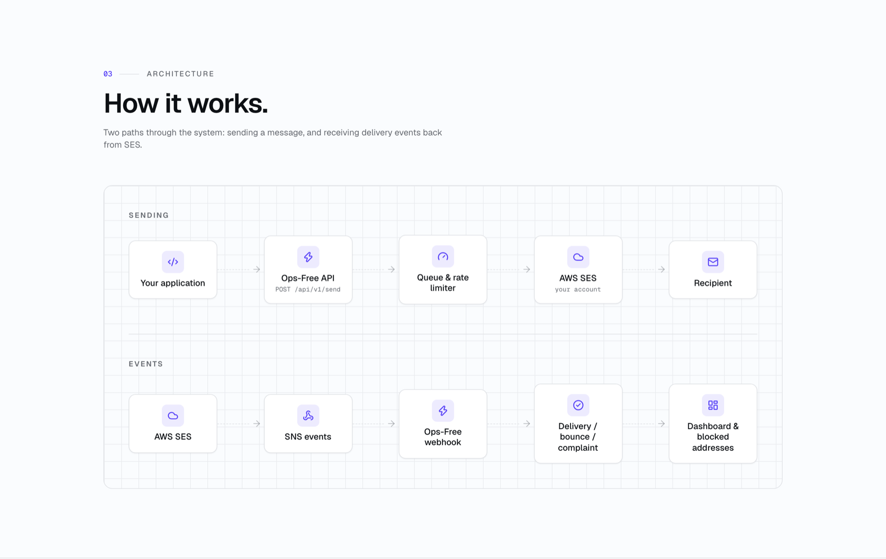

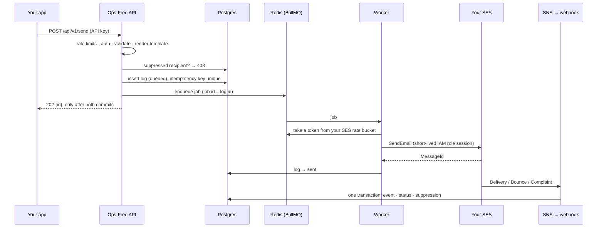

The Next.js app (API, dashboard and SNS webhook) runs on Vercel. A separate long-running worker is the only process that calls SES. More detail, trust boundaries and design decisions: [`docs/ARCHITECTURE.md`](docs/ARCHITECTURE.md).

## Engineering highlights

**Delivery guarantees**, each backed by a test:

| Guarantee | How |
|---|---|
| A `202` means the message is durably accepted | The log row is committed and the job enqueued before responding; otherwise `503` |
| No duplicate sends on client retries | `Idempotency-Key` header, unique per account; job id = log id |
| Crash-safe delivery | BullMQ stalled-job recovery; tested by killing workers mid-delivery |
| No re-send after SES accepted a message | "Accepted by SES" is recorded on the job before any database write |
| Your SES send rate is never exceeded | Per-account token bucket in Redis (Lua script, Redis clock) |
| Suppressed addresses never reach SES | Checked at acceptance **and** again right before sending |
| Each SNS event applied exactly once | SNS `MessageId` is unique, in the same transaction as its effects |

**Measured under failure** ([full evidence](docs/testing/EVIDENCE.md)):

- **2,000 messages, 4 accounts, 3 workers:** 478 messages/s, 0 lost, 0 duplicates. The busiest second for any account was 199 against a limit of 200.
- **Workers killed every 400 ms mid-delivery:** 600/600 delivered, 0 duplicates.
- **Redis killed and restarted with 300 jobs queued:** 300/300 delivered, 0 duplicates.

**Security:**

- **One-click AWS connect** through a CloudFormation-created IAM role: no long-lived AWS keys are stored. Keys pasted the old way are encrypted with AES-256-GCM, using a rotatable master key.
- **API keys** are stored as SHA-256 hashes and shown once.
- **SNS webhooks** verify the RSA signature and that the topic belongs to the account.
- **Tenant isolation is tested**: one account calls every data function with another account's IDs, and the other account's 12 tables are checked byte-for-byte afterwards.
- **The database's public API is closed** (row-level security on every table, no anonymous grants).
- **Cloudflare Turnstile** on sign-up and sign-in, per-IP and per-key rate limits, a 2 MB body cap, and a security audit with 13 findings ([`docs/security/AUDIT.md`](docs/security/AUDIT.md)).

## Free tools

Public, no sign-up. Built to bring developers to the site.

| | |
|---|---|
| 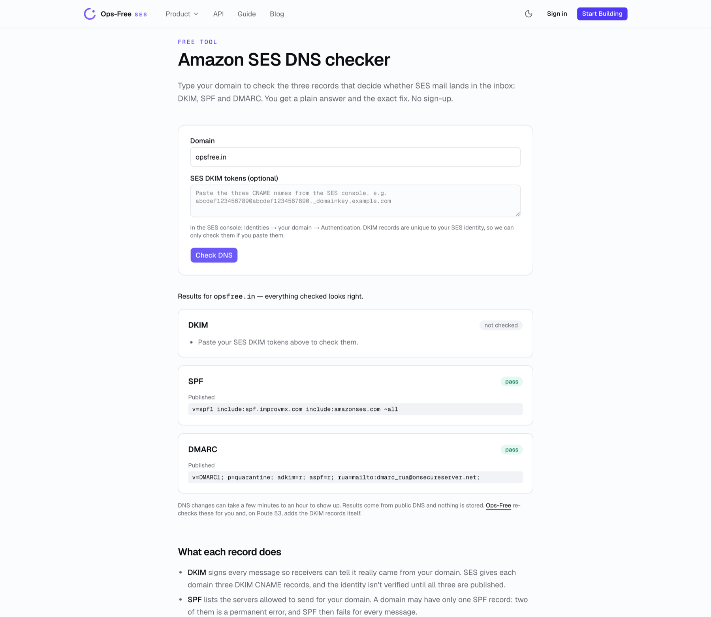 | 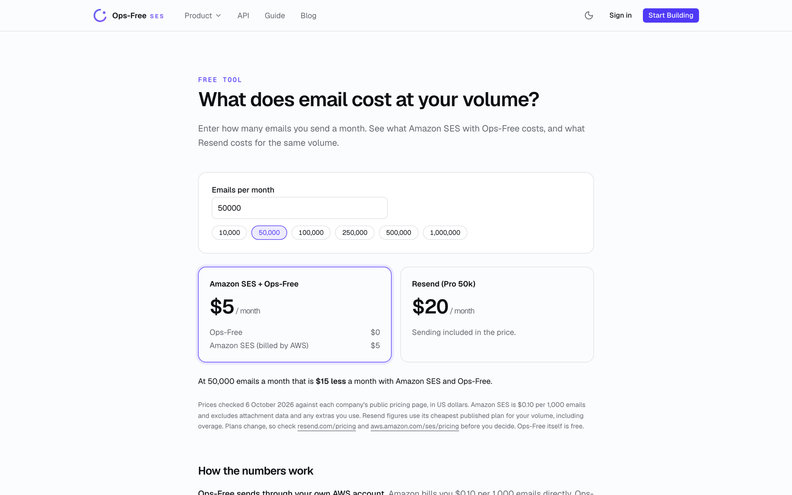 |
| **SES DNS checker.** Checks DKIM, SPF and DMARC and explains the exact fix. | **Cost calculator.** Amazon SES with Ops-Free vs Resend at your volume. |

There's also a **production access writer** that drafts the SES sandbox-exit request, and a [blog](https://www.opsfree.in/blog) with three guides on SES.

## Tech stack

| Layer | Choice |
|---|---|
| App | Next.js 15 (App Router, Server Components, Server Actions), React 19, TypeScript (strict) |
| UI | Tailwind CSS v4, shadcn/ui, light and dark themes, works at phone width |
| Data | PostgreSQL on Supabase, Drizzle ORM with versioned migrations |
| Auth | Supabase Auth (email + Google), Cloudflare Turnstile |
| Queue | BullMQ on Redis, with a custom Lua token-bucket rate limiter |
| Email | AWS SDK v3 (SESv2, SNS, STS, Route 53), a CloudFormation template for one-click connect |
| Testing | Vitest with PGlite (real Postgres in WASM) and a real `redis-server`, Playwright end-to-end |
| Ops | Vercel (app), Railway (worker), Sentry, GitHub Actions CI gating production deploys |

<p align="center">
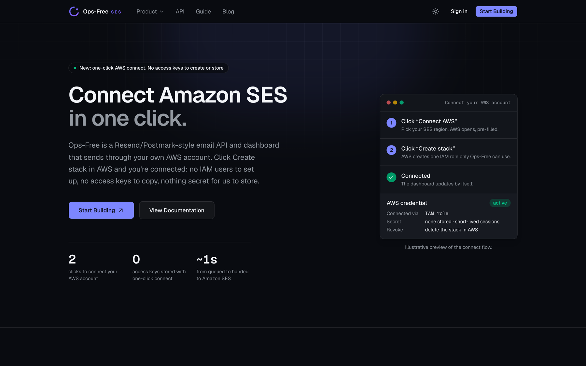
&nbsp;
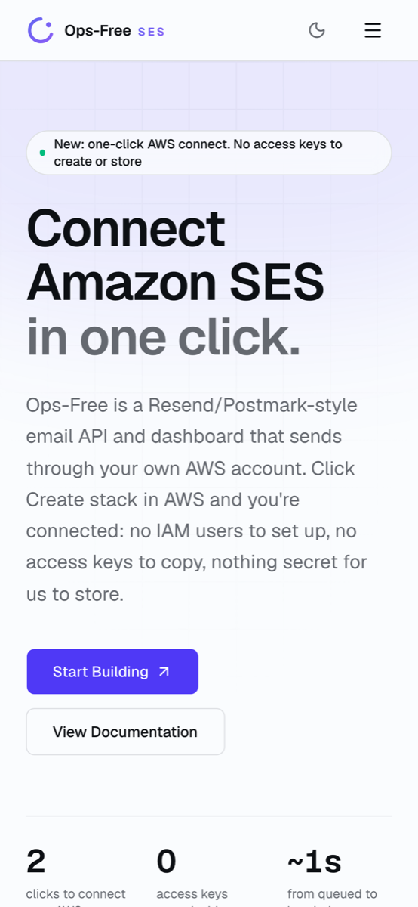
</p>

## Run it locally

```bash
npm install
cp .env.example .env.local   # Supabase, Redis and a generated ENCRYPTION_KEY
npm run db:migrate

brew services start redis    # queue backend for development

npm run dev       # terminal 1: API + dashboard on http://localhost:3000
npm run worker    # terminal 2: the delivery worker
```

Both processes are needed: the app accepts sends and the worker delivers them (`/dashboard/health` warns when no worker is running). SES delivery events arrive at `POST /api/v1/webhooks/aws-sns`, which must be reachable over public HTTPS, since SNS can't post to localhost.

To switch the hosted service between paused and live, set `SERVICE_PAUSED` in [`src/lib/service-status.ts`](src/lib/service-status.ts).

## Testing

```bash
npm test                  # 1,027 tests: unit, integration, security guards
npm run test:resilience   # stress, chaos, outage and replay tests
npm run test:e2e          # Playwright against a running app
npm run typecheck && npm run typecheck:worker
```

Integration tests run the real repositories and migrations against PostgreSQL in WASM, and the real queue against a throwaway `redis-server`. No Docker, AWS account or hosted database needed. Requires `redis-server` and `openssl` on your PATH.

## Project structure

```
src/
  app/api/v1/       public API: send, domain verify, SNS + AWS-connect webhooks
  app/dashboard/    one folder per dashboard screen (pages + Server Actions)
  app/tools/        free public tools; app/blog/ guides
  server/           account-scoped data access and business logic
  lib/              pure logic: crypto, SES/SNS parsing, DNS checks, templates,
                    queue and rate limiter, production-access generator
worker/             standalone BullMQ worker: delivery + domain verification polling
drizzle/            versioned SQL migrations
tests/              unit · integration · resilience · e2e
docs/               architecture, phase notes, security audit, test evidence, operations
```

## How it was built

Built in phases against a written spec ([`docs/Ops-Free_Amazon_SES_Engine_SRS.pdf`](docs/Ops-Free_Amazon_SES_Engine_SRS.pdf)). Each phase was finished, tested and documented before the next started:

1. Core sending engine · [notes](docs/PHASE-1.md)
2. Queue, rate limiting and retries · [notes](docs/PHASE-2.md)
3. Domains, SNS webhooks and suppression · [notes](docs/PHASE-3.md)
4. Dashboard and developer experience · [notes](docs/PHASE-4.md)
5. Templates · [notes](docs/PHASE-5.md)
6. SES sandbox exit assistant · [notes](docs/PHASE-6.md)
7. Production hardening: security audit, chaos tests, observability · [notes](docs/PHASE-7.md)
8. Guided onboarding and setup automation · [notes](docs/PHASE-8.md)
9. Sandbox and "waiting for AWS" experience · [notes](docs/PHASE-9.md)
10. One-click AWS connect through CloudFormation · [notes](docs/PHASE-10.md)

Operations docs (deployment, observability, runbook, backup and recovery) are in [`docs/operations/`](docs/operations/).

---

<p align="center"><sub>Built by <a href="https://github.com/armaanyt07-jpg">Armaan</a>. Ops-Free is not affiliated with Amazon Web Services.</sub></p>
