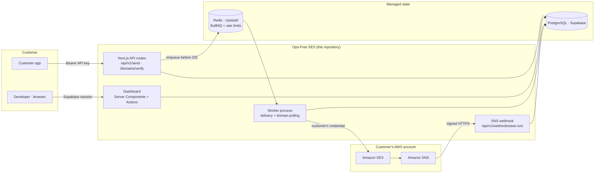
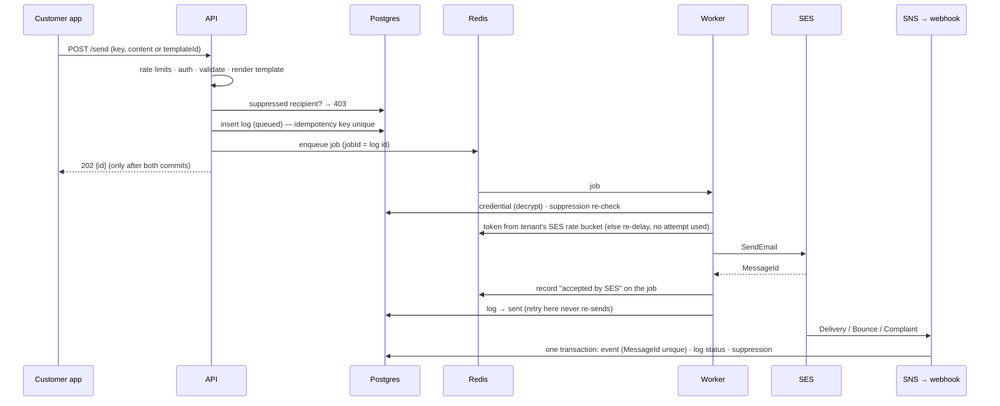

# Architecture

A Resend-style API and dashboard over **customer-owned** Amazon SES. The
platform holds each customer's AWS credential (encrypted) and does the sending
through *their* SES account, so deliverability, quotas and reputation stay in
the customer's AWS account.

Source of truth: `docs/Ops-Free_Amazon_SES_Engine_SRS.pdf`. Phase notes:
`docs/PHASE-1.md` … `docs/PHASE-7.md`.

## System



| Component | Runs on | Responsibility |
| --- | --- | --- |
| Next.js app | Vercel (serverless) | API, dashboard, SNS webhook |
| Worker | container host (Railway / Fly / Render / ECS) | the only SES caller; domain-verification polling |
| PostgreSQL | Supabase | durable state: tenants, credentials, keys, logs, events, templates, suppression, audit |
| Redis | Upstash | BullMQ queues; distributed token buckets |
| SES / SNS | customer's AWS account | delivery; delivery/bounce/complaint events |

The worker is separate because SRS §15 says long-lived BullMQ workers must not
run as serverless request handlers.

## Trust boundaries

| Boundary | Who crosses | Authentication | Authorization |
| --- | --- | --- | --- |
| Public API | customer apps | API key → SHA-256 lookup | the key's tenant + environment; per-IP limit before the DB, per-key limit after |
| Dashboard | developers | Supabase Auth session (JWT revalidated) | tenant from the session, never from input; every action calls `requireTenant()` |
| Webhook | Amazon SNS | RSA signature (cert host-restricted) | topic ARN must be registered; its owner is the tenant |
| Database | the app and worker only | `postgres` role | **Data API closed**: no anon/authenticated grants, RLS on every table |
| AWS | the worker (and dashboard validation) | the customer's own IAM key, decrypted in memory | least privilege: `ses:GetAccount`, `SendEmail`, `CreateEmailIdentity`, `GetEmailIdentity` |

Secrets: AWS secret keys are AES-256-GCM encrypted with a master key held
only in the server environment (rotatable, keyring). API keys are stored as
hashes and shown once. Nothing secret is logged, and a test checks that.

## A message's life



Guarantees, and where they're enforced:

| Guarantee | Mechanism |
| --- | --- |
| A 202 means durably accepted | log committed and job enqueued before responding; otherwise 503 |
| No duplicate acceptance | unique `(user_id, idempotency_key)`; `jobId` = log id |
| Crash-safe delivery | BullMQ stalled-job recovery; tested by killing workers mid-delivery |
| No re-send after success | `acceptedBySes` recorded on the job before any DB write |
| SES rate respected | per-tenant token bucket in Redis (Lua, Redis clock) |
| Suppressed never reach SES | checked at acceptance *and* right before SES |
| Exactly-once event effects | SNS `MessageId` unique in the same transaction as the effects |
| Order-independent state | outcome severity only ratchets up (delivered < bounced < complained) |

Delivery is **at-least-once** at the SES boundary. The one remaining duplicate
window is a crash in the milliseconds between SES answering and the acceptance
record being written to Redis. It's documented, bounded by in-flight jobs, and
0 in every test run.

## Code map

```
src/app/api/v1/        public API routes (error boundary, limits, auth)
src/app/api/health/    liveness, readiness
src/app/dashboard/     pages + Server Actions (one folder per screen)
src/server/            tenant-scoped data access and domain logic ("server-only")
src/lib/               pure logic: crypto, SES/SNS parsing, DNS, templates,
                       sandbox request generator, queue, rate limiter, observability
worker/                standalone worker process
drizzle/               versioned SQL migrations (0000–0005)
scripts/               preflight, load test, reconcile, key rotation
tests/                 unit · integration · resilience
```

## Data model (tables)

`users` · `aws_credentials` · `api_keys` · `verified_domains` ·
`email_templates` + `email_template_versions` · `email_logs` ·
`suppression_list` · `sns_topics` · `sns_events` · `audit_logs` ·
`sandbox_requests`. Every table carries `user_id` (cascading from `users`),
every query filters on it, and RLS is enabled on all of them. The SRS §6
baseline columns are unchanged; each phase's additions are listed at the top
of `src/db/schema.ts`.

## Decisions record

| Decision | Where argued |
| --- | --- |
| Enqueue before 202; separate worker | `PHASE-2.md` §1–2 |
| Own rate limiter, per tenant, Redis clock | `PHASE-2.md` §2.1 |
| Topic ARN identifies the tenant; one transaction per event | `PHASE-3.md` §2 |
| SES is the only authority on domain verification | `PHASE-3.md` §2.3 |
| Shared acceptance pipeline for API and dashboard | `PHASE-4.md` §2.1 |
| Interpolation-only template engine, context-aware escaping | `PHASE-5.md` §2 |
| Deterministic, non-fabricating production-access generator | `PHASE-6.md` §2 |
| Data API lock-down, abuse limits, error boundary, no-resend | `security/AUDIT.md`, `PHASE-7.md` |
